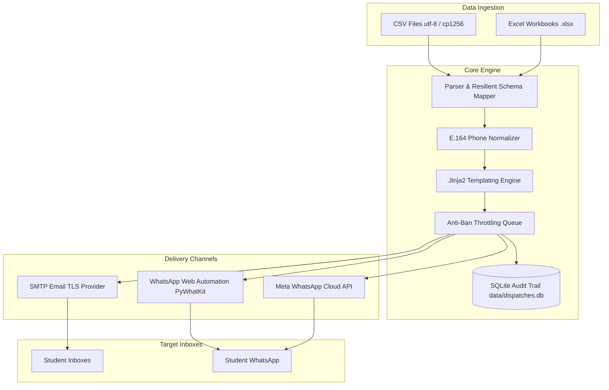

# 📬 Multi-Channel Academic Notification & Dispatch System

[](https://www.python.org/downloads/)
[]()
[]()
[]()

An enterprise-ready, multi-channel academic notification and automation engine designed to dispatch student grade slips, attendance alerts, and academic notices via **WhatsApp** and **Email (SMTP)**.

Features built-in **rate limiting**, **anti-ban randomized throttling**, **bilingual spreadsheet ingestion** (Arabic/English), **responsive Jinja2 templating**, and **SQLite audit logging**.

---

## 🏗️ Architecture Overview



---

## ✨ Key Features

- **📊 Multi-Format Ingestion**: Supports `.csv` and `.xlsx` files with resilient header detection across English and Arabic aliases (e.g. `phone`, `موبايل`, `whatsapp`, `الاسم`, `كود الطالب`).
- **📱 Intelligent Phone Normalization**: Automatically normalizes Egyptian local numbers (`010...`, `011...`, `012...`, `015...`) and international numbers into global **E.164** format (e.g. `+201120844781`).
- **🎨 Dynamic Jinja2 Templating**:
  - **WhatsApp**: Standard clean format or styled emoji card with automated score breakdowns.
  - **Email**: Modern responsive HTML cards and retro cyberpunk terminal reports.
- **🛡️ Anti-Ban Rate Limiting**: Randomized delays between dispatches to mimic natural human behavior and prevent WhatsApp account bans.
- **📜 SQLite Audit Trail**: Automatically tracks dispatch events, statuses (`SUCCESS`, `FAILED`, `SKIPPED`), timestamps, and error messages in `data/dispatches.db`.
- **💻 Interactive CLI**: Rich console interface with color-coded live progress, previews, and dry-run safety modes.

---

## 📁 Repository Structure

```
├── src/
│   ├── core/
│   │   ├── config.py             # Configuration & environment variable loader
│   │   ├── database.py           # SQLite audit logger (dispatches table)
│   │   └── models.py             # Pydantic data schemas & status enums
│   ├── services/
│   │   ├── dispatcher.py         # Batch orchestrator with throttling
│   │   ├── email_service.py      # Production SMTP client with TLS & multipart
│   │   ├── templating.py         # Jinja2 template manager
│   │   └── whatsapp_service.py   # WhatsApp delivery providers (PyWhatKit, Meta, Mock)
│   ├── templates/
│   │   ├── email_grade_report.html.j2    # Responsive HTML student grade slip
│   │   ├── email_retro_alert.html.j2     # Retro cyberpunk terminal email
│   │   ├── wa_grade_report.txt.j2        # Standard academic WhatsApp notice
│   │   └── wa_grade_report_styled.txt.j2 # Styled WhatsApp card with emojis
│   └── utils/
│       ├── parser.py             # Resilient Excel / CSV reader
│       └── phone.py              # International phone normalization (phonenumbers)
├── data/
│   ├── dispatches.db             # SQLite audit database (auto-generated)
│   ├── students_sample.csv       # Sample CSV dataset
│   └── students_sample.xlsx      # Sample Excel workbook
├── tests/
│   ├── test_dispatcher.py        # Dispatcher & dry-run tests
│   ├── test_parser.py            # Spreadsheet parsing & alias matching tests
│   ├── test_phone.py             # Phone number normalization tests
│   └── test_templates.py         # Jinja2 template rendering tests
├── .env.example                  # Environment configuration template
├── requirements.txt              # Required Python packages
├── pytest.ini                    # Pytest configuration
├── main.py                       # CLI application entry point
└── README.md
```

---

## 🚀 Quickstart & Setup

### 1. Install Dependencies
```bash
pip install -r requirements.txt
```

### 2. Configure Environment Variables
Copy `.env.example` to `.env`:
```bash
cp .env.example .env
```

Open `.env` and fill in your settings:
```ini
# ==========================================
# Email Configuration (SMTP)
# ==========================================
SMTP_HOST=smtp.gmail.com
SMTP_PORT=587
SMTP_USER=your_email@gmail.com
SMTP_PASSWORD=your_16_char_google_app_password
SMTP_FROM_EMAIL=your_email@gmail.com
SMTP_FROM_NAME="Student Academic Portal"
SMTP_USE_TLS=true

# ==========================================
# WhatsApp Provider Configuration
# Options: pywhatkit (default), meta, mock
# ==========================================
WA_PROVIDER=pywhatkit

# Meta Cloud API (Only if WA_PROVIDER=meta)
META_WA_PHONE_NUMBER_ID=
META_WA_ACCESS_TOKEN=

# ==========================================
# Anti-Ban Throttling Settings
# ==========================================
MIN_DELAY_SECONDS=5.0
MAX_DELAY_SECONDS=12.0

# Database
DB_PATH=data/dispatches.db
```

> [!NOTE]
> For Gmail SMTP, generate a 16-character **App Password** from:
> [Google Account Security -> 2-Step Verification -> App Passwords](https://myaccount.google.com/apppasswords).

---

## 📋 Supported Spreadsheet Columns

The system automatically recognizes both English and Arabic column names:

| Canonical Field | Recognized Aliases (Case-Insensitive) | Description |
|:---|:---|:---|
| **student_id** | `id`, `student_id`, `code`, `كود الطالب`, `رقم القيد`, `الرقم التعريفي` | Student ID (Required) |
| **name** | `name`, `student_name`, `full_name`, `اسم الطالب`, `الاسم` | Full Name (Required) |
| **phone** | `phone`, `mobile`, `cell`, `whatsapp`, `رقم الهاتف`, `الموبايل`, `الواتساب` | Mobile number (Required) |
| **email** | `email`, `student_email`, `mail`, `البريد`, `البريد الإلكتروني` | Email address (Optional) |
| **course** | `course`, `course_name`, `subject`, `المادة`, `المقرر` | Course Title |
| **midterm** | `midterm`, `mid`, `نصفي`, `أعمال سنة` | Midterm score |
| **lab** | `lab`, `practical`, `عملي`, `المختبر` | Practical score |
| **oral** | `oral`, `شفوي`, `الشفهي` | Oral score |
| **bonus** | `bonus`, `extra`, `بونص`, `إضافي` | Bonus points |
| **total** | `total`, `score`, `grade`, `المجموع`, `الدرجة النهائية` | Total score (auto-calculated if omitted) |
| **notes** | `notes`, `remarks`, `comments`, `ملاحظات` | Feedback note |

---

## 💻 CLI Commands & Usage

The application provides an interactive CLI through `main.py`.

### 1. Test Service Connectivity
Verify your SMTP credentials and WhatsApp environment before dispatching:
```bash
python main.py test-connection --channel all
```

### 2. Preview Rendered Messages
Preview the rendered messages without sending:
```bash
# Preview both WhatsApp and Email
python main.py preview --file data/students_sample.csv --channel both

# Preview a specific student by ID
python main.py preview --file data/students_sample.csv --id 220769 --channel wa

# Preview using the styled emoji WhatsApp template
python main.py preview --file data/students_sample.csv --template-wa wa_grade_report_styled.txt.j2

# Preview using the retro cyberpunk email template
python main.py preview --file data/students_sample.csv --template-email email_retro_alert.html.j2
```

### 3. Dry-Run Batch Simulation (Recommended First)
Simulate dispatching an entire batch with mock delivery and SQLite audit recording:
```bash
python main.py send --file data/students_sample.xlsx --channel both --dry-run
```

### 4. Live Batch Dispatch
Dispatch live notifications across chosen channels:

- **WhatsApp Only**:
  ```bash
  python main.py send --file data/students_sample.xlsx --channel wa
  ```

- **Email Only**:
  ```bash
  python main.py send --file data/students_sample.xlsx --channel email
  ```

- **Both Channels**:
  ```bash
  python main.py send --file data/students_sample.xlsx --channel both
  ```

- **Custom Anti-Ban Delays**:
  ```bash
  python main.py send --file data/students_sample.xlsx --channel wa --min-delay 8 --max-delay 18
  ```

### 5. View SQLite Audit History
Display recent dispatches, delivery statuses, and summary counters:
```bash
python main.py history --limit 25
```

Filter by channel:
```bash
python main.py history --channel wa
```

### 6. Generate Sample Data Files
Create starter `.csv` and `.xlsx` templates in `data/`:
```bash
python main.py generate-sample
```

---

## 🧪 Automated Testing

Run the full pytest suite:
```bash
python -m pytest tests/
```

Test suite coverage:
- **`test_phone.py`**: Validates Egyptian local formatting, international prefixing, Excel numeric handling, and dirty inputs.
- **`test_parser.py`**: Verifies CSV & Excel ingestion, multilingual column alias mapping, and error isolation.
- **`test_templates.py`**: Confirms rendering of WhatsApp and Email templates with Pydantic records.
- **`test_dispatcher.py`**: Validates rate-limiting orchestration, skipped email detection, and SQLite audit records.

---

## 🔒 Security Best Practices

1. **Never commit `.env`**: Always ensure `.env` is listed in `.gitignore`.
2. **Revoke Exposed Credentials**: If you ever committed a plain-text password to git, revoke it immediately in your Google account security settings and generate a fresh one.
3. **Anti-Ban Compliance**: When sending to high volumes of students on WhatsApp, keep `MIN_DELAY_SECONDS` at 8–15s to comply with messaging limits.

---

## 📄 License
This project is licensed under the MIT License.
